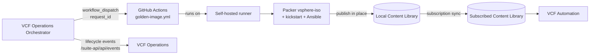

# packer-golden-images

Companion repo for the **goldRush** series on [jonschulz.com](https://jonschulz.com):
one GitHub Actions workflow that builds **RHEL 9** and **Oracle Linux 9** golden
images with Packer, publishes them into a vSphere Content Library *in place*,
and proves it worked.

This is a sanitized copy of the code that runs in my lab. Every lab-specific
value has been swapped for a placeholder, so you'll need to fill in your own
environment before anything builds. The code is kept close to the original so
the blog posts can quote it line for line.

## How it fits together



1. **VCF Operations Orchestrator** (or you, from the Actions tab) dispatches
   `golden-image.yml` with an `os`, an `image_name` and an optional
   `request_id` so the caller can find its own run.
2. The job runs on a **self-hosted runner** that can reach vCenter.
3. `packer/build.sh` drives **Packer's `vsphere-iso` builder**: the VM boots the
   DVD ISO, installs from a **kickstart**, then **Ansible** updates, hardens and
   cleans it.
4. Packer exports the VM as an OVF straight into a **local Content Library**,
   replacing the existing item *in place* (same item UUID, new
   `content_version`).
5. The workflow syncs the **subscribed library** that **VCF Automation**
   consumes, verifies the subscriber caught up, and writes a provenance
   manifest.
6. Lifecycle events (started / succeeded / failed) are reported to **VCF
   Operations** by the Orchestrator side of the flow. The messages carry the
   tokens `GOLDRUSH_BUILD_STARTED`, `GOLDRUSH_BUILD_SUCCEEDED` and
   `GOLDRUSH_BUILD_FAILED`, and the matching symptom and alert definitions are
   in [`vcf-operations/`](vcf-operations/). The Orchestrator workflows that
   dispatch, poll and post are in [`orchestrator/`](orchestrator/).
   Heads-ups: every event is posted as `INFORMATION` (Failed only *looks*
   critical because of its Ops symptom), message-event alerts don't
   auto-clear, and the Orchestrator poll loop stops after `timeoutMinutes`
   (default 90), cancels the GitHub run and posts FAILED with
   `Status: timed_out` (see [Poll timeout](orchestrator/README.md#poll-timeout)).

## Repository layout

```text
.github/workflows/golden-image.yml   # the pipeline (validate | build)
scripts/                             # Content Library helpers (vCenter REST API)
  library-item-details.sh            #   look up an item by library + name
  validate-library-update.sh         #   prove the update happened in place
  sync-subscribed-library-item.sh    #   sync + wait for the subscriber
  create-build-manifest.sh           #   provenance manifest + SHA-256
packer/                              # build side (derived from Packer Examples for vSphere)
  build.sh                           #   CI-safe build driver
  project.json                       #   trimmed to RHEL 9 + Oracle Linux 9
  builds/linux/rhel/9/               #   vsphere-iso template, variables, kickstart
  builds/linux/oracle/9/
  ansible/                           #   base / users / configure / clean roles
  config/example/*.pkrvars.hcl.example  # copy these and fill in your values
docs/gotchas.md                      # the seven things that broke, and the fixes
vcf-operations/                      # VCF Operations symptom + alert definitions
orchestrator/                        # Orchestrator workflows, scripts, config element examples
.env.example                         # runtime secrets for local runs
THIRD_PARTY_LICENSES/                # upstream BSD-2-Clause license + notice
```

## Prerequisites

- vCenter (vSphere 8 / VCF 9 era) with:
  - a datastore holding the **full DVD ISO** for each OS (see
    [docs/gotchas.md](docs/gotchas.md) for uploading a 16 GB ISO with `curl`),
  - a **local Content Library** Packer publishes into, and
  - a **subscribed Content Library** (on the same or another vCenter) that VCF
    Automation consumes. Automatic sync can stay off; the workflow triggers it.
  - a port group / segment with **DHCP** for the build VM.
- A least-privilege vCenter service account for Packer, and read/sync access on
  the subscriber side.
- A **self-hosted GitHub Actions runner** with `bash`, `curl`, `git`, `jq`,
  `sha256sum`, **Packer >= 1.12** and **ansible-core**, and network access to
  vCenter and the build network (Packer serves the kickstart over HTTP on
  ports 8000-8099).
- A Red Hat account for RHEL builds (Simple Content Access, so no
  `--autosubscribe`).

## Configure

### 1. Packer variables

Real-value files are never committed (`.gitignore` blocks `*.pkrvars.hcl`).
Copy the examples to a directory **outside** the checkout on your runner:

```bash
sudo mkdir -p /opt/golden-images/config
for f in packer/config/example/*.pkrvars.hcl.example; do
  sudo cp "$f" "/opt/golden-images/config/$(basename "${f%.example}")"
done
```

Then replace the placeholders:

| Placeholder | File | What it is |
|---|---|---|
| `vcenter.example.com` | `vsphere.pkrvars.hcl` | vCenter FQDN |
| `<DATACENTER>` | `vsphere.pkrvars.hcl` | vSphere datacenter |
| `<CLUSTER>` | `vsphere.pkrvars.hcl` | cluster the build VM runs in |
| `<DATASTORE>` | `vsphere.pkrvars.hcl` | datastore for the build VM |
| `<PORTGROUP_OR_SEGMENT>` | `vsphere.pkrvars.hcl` | DHCP-enabled build network |
| `<VM_FOLDER>` | `vsphere.pkrvars.hcl` | VM folder for build VMs |
| `<SOURCE_CONTENT_LIBRARY>` | `common.pkrvars.hcl` | local library Packer publishes into |
| `<ISO_DATASTORE>` | `common.pkrvars.hcl` | datastore holding the ISOs |
| `iso_*` values | `linux-rhel-9.pkrvars.hcl`, `linux-oracle-9.pkrvars.hcl` | ISO path / file name on that datastore |

`build.pkrvars.hcl`, `ansible.pkrvars.hcl`, `network.pkrvars.hcl`,
`proxy.pkrvars.hcl` and `rhsm.pkrvars.hcl` hold no secrets; `rhsm.pkrvars.hcl`
is intentionally empty but `build.sh` expects it for RHEL.

> Prefer committing your config? Use a **private** fork and pass a path
> relative to `packer/` as `config_path`.

### 2. GitHub Actions secrets and variables

| Name | Type | Used for |
|---|---|---|
| `SOURCE_VCENTER` | secret | vCenter that owns the local library |
| `SOURCE_VCENTER_USERNAME` / `SOURCE_VCENTER_PASSWORD` | secret | Packer + library checks on the source side |
| `SUBSCRIBER_VCENTER` | secret | vCenter that owns the subscribed library |
| `SUBSCRIBER_VCENTER_USERNAME` / `SUBSCRIBER_VCENTER_PASSWORD` | secret | subscriber sync + checks |
| `BUILD_PASSWORD` / `BUILD_PASSWORD_ENCRYPTED` | secret | guest build account (clear + crypted) |
| `RHSM_USERNAME` / `RHSM_PASSWORD` | secret | RHEL registration (only exposed to `os: rhel-9`) |
| `BUILD_KEY` / `ANSIBLE_KEY` | variable | public SSH keys for the build / Ansible accounts |

For local runs, [`.env.example`](.env.example) lists the same values as
`PKR_VAR_*` environment variables.

## Run it

### From GitHub Actions

**Actions -> Golden Image Build -> Run workflow**:

```text
mode:               validate | build
os:                 oracle-9 | rhel-9
image_name:         linux-rhel-9.9-<version>   # must start with linux-<os_name>-<os_version>-
source_library:     <your local library>
subscribed_library: <your subscribed library>
config_path:        /opt/golden-images/config
request_id:         (optional, shows up in the run name)
```

Start with `validate`: it checks the runner, your config files and secrets,
and both Content Library lookups without building anything.

### From VCF Operations Orchestrator (or anything with an HTTP client)

The Orchestrator workflow simply calls the GitHub REST API:

```http
POST https://api.github.com/repos/<OWNER>/<REPO>/actions/workflows/golden-image.yml/dispatches
Authorization: Bearer <FINE_GRAINED_TOKEN_WITH_ACTIONS_WRITE>
Accept: application/vnd.github+json

{"ref": "main", "inputs": {"mode": "build", "os": "rhel-9",
  "image_name": "linux-rhel-9.9-<version>", "request_id": "<CALLER_ID>"}}
```

It then finds its own run by `request_id` in the run name and polls it. The
real Orchestrator workflows (dispatch, find-run, poll and the VCF Operations
events) are in [`orchestrator/`](orchestrator/).

### Locally

```bash
set -a; source .env; set +a
cd packer
./build.sh --os Linux --dist "Red Hat Enterprise Linux" --version 9 \
  --auto-continue /opt/golden-images/config
```

## What "success" means

Before the build, the workflow checks the runner, the config files and every
required secret. After Packer finishes it **fails** unless:

- the Content Library item UUID, library ID and `creation_time` are unchanged,
- `last_modified_time` advanced and `content_version` increased, and
- the subscribed item reports the same source item and `content_version`, with
  content cached.

On the very first build of a new `image_name`, Packer creates the item, the
in-place comparison is skipped, and the subscribed library is synced at the
library level so the new item appears.

Every build gets an immutable version, `YYYY.MM.DD.<run-number>-<short-sha>`,
and uploads `before.json`, `after.json` and a `golden-image-manifest.json`
(+ `.sha256`) as a run artifact kept for 90 days. The item name and UUID stay
the stable identity VCF Automation points at.

## Blog series

The goldRush series on [jonschulz.com](https://jonschulz.com):

1. **One Workflow, Two Distros** (coming soon)
2. **Find Your Run, Not a Run** (coming soon)
3. **The Ampersand That Broke My Golden Image** (coming soon)
4. **Green Means Green** (coming soon)
5. **Set It and Forget It** (coming soon)

## Credits

The `packer/` directory is derived from
[Packer Examples for vSphere](https://github.com/vmware-samples/packer-examples-for-vsphere)
(v0.22.1) by Broadcom, licensed under BSD-2-Clause. It's an excellent project,
so go give it a star. Changes here: trimmed to RHEL 9 and Oracle Linux 9,
CI-safe `build.sh` (real exit codes, `-on-error=abort`), base64-quoted RHSM
registration in the kickstart, and a fail-fast RHSM check in Ansible. The
upstream license and notice are in
[THIRD_PARTY_LICENSES/packer-examples-for-vsphere](THIRD_PARTY_LICENSES/packer-examples-for-vsphere).

## License

Original work in this repo is [MIT](LICENSE). Files under `packer/` keep
their upstream BSD-2-Clause license and copyright notices.
